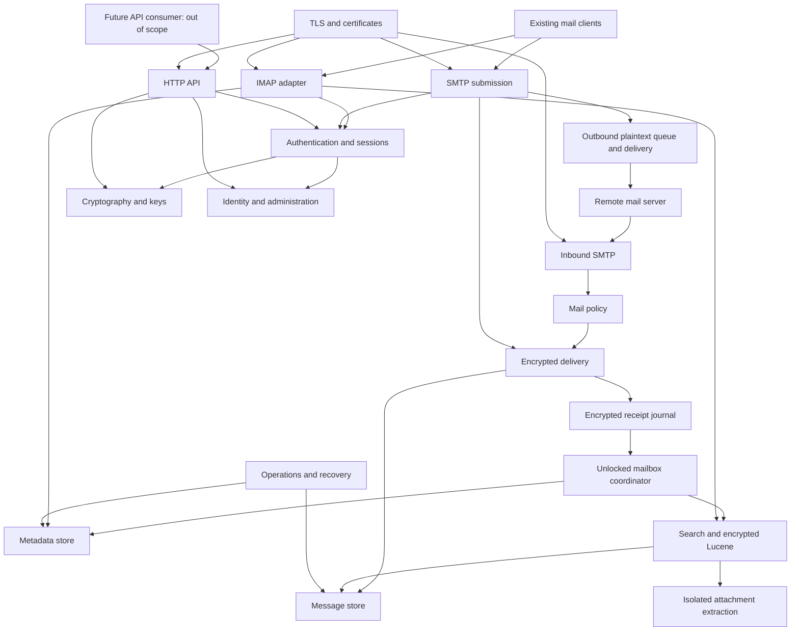

# Shem Server Implementation Plan

Status: proposed architecture and delivery plan; implementation in progress — see [docs/STATUS.md](docs/STATUS.md) and the [architecture decision records](docs/adr/README.md).

Source: [Zero-access opslag van e-mail whitepaper](whitepaper.md), particularly sections 3-6, 8, and 9. These English documents translate the server-side design into implementation boundaries; they do not silently replace the whitepaper's security model.

## Scope

Build a self-hosted Java mail server with SMTP reception, SMTP submission, outbound delivery, IMAP, encrypted mailbox storage and search, account/key management over an HTTP API, and automatic TLS certificate management. Deliver one versioned distribution, with separately runnable roles where isolation requires it. No external database is required.

Client applications, browser UI, browser cryptography, mobile applications, and webmail are out of scope. Existing IMAP/SMTP clients remain supported. HTTP provides the server-side management and self-service contract for a future client, not a frontend implementation.

This is zero-access **at rest**, not end-to-end encryption or protection against a compromised running host. Plaintext and unlocked keys exist temporarily in memory. The outbound queue is an explicit plaintext-on-disk exception. Server configuration, routing records, public keys, TLS/ACME keys, and DKIM keys are outside mailbox encryption and require separate protection.

## Proposed Technical Baseline

- Java 25 LTS, without preview features, subject to validating James and cryptographic-provider compatibility. If the spike requires Java 21 LTS, record that decision before scaffolding; James's minimum version is not automatically Shem's target version.
- Maven multi-module build (no Maven Wrapper), pinned plugin/dependency versions, a BOM where appropriate, and a single release version. Module names follow the component catalog below, but a document is a logical boundary, not a requirement for its own Maven module.
- Reuse Apache James protocol/mailbox modules in a custom application, not the James server distribution, default persistence, or default queues. Candidate libraries: Mime4J, jSPF, jDKIM, Lucene, Bouncy Castle, Tika, and acme4j. Verify maintained releases, licenses, APIs, and compatibility before selecting versions.
- Use established cryptographic constructions and formats. The authenticated random-access file format and key-envelope profile require explicit design review, test vectors, and versioning before production use.
- Keep domain/storage services independent of protocol frameworks. Select the HTTP framework in the initial spike based on streaming, TLS reload, security controls, dependency footprint, and integration with the chosen runtime. No frontend stack is needed.
- One mailbox writer/coordinator per mailbox; bounded queues, memory, parser work, and Argon2id concurrency. Virtual threads are suitable for blocking adapters, not a substitute for admission control or an excuse to block James event loops.

## Component Catalog

Each linked specification defines responsibilities, collaborators, persistence, failure behavior, and acceptance checks.

| Component | Ownership | Whitepaper |
| --- | --- | --- |
| [Runtime and isolation](docs/components/runtime.md) | Composition, process roles, IPC, lifecycle, resource budgets | 5.5, 5.9, 6.2 |
| [Identity and administration](docs/components/identity.md) | Domains, accounts, aliases, enrollment state, roles, quotas | 5.8, 6.2 |
| [Cryptography and key management](docs/components/cryptography.md) | Key hierarchy, slots, envelopes, rotation, crypto-erase | 5.1, 5.3, 6.2 |
| [Authentication and sessions](docs/components/sessions.md) | Shared authentication controls, unlock leases, revocation, MFA | 5.3, 5.8 |
| [Inbound SMTP](docs/components/smtp-inbound.md) | Port 25, protocol admission, durable acceptance boundary | 5.2, 5.5 |
| [Mail policy and filtering](docs/components/mail-policy.md) | SPF/DKIM/DMARC, greylisting, spam, attachment safety, routing rules | 5.2, 5.7 |
| [Encrypted delivery](docs/components/delivery.md) | Locked-mailbox delivery, encrypted receipts, replay, idempotency | 5.2, 5.3, 5.10 |
| [Message store](docs/components/message-store.md) | Immutable ciphertext blobs and envelope references | 5.1, 5.10 |
| [Metadata store](docs/components/metadata-store.md) | Folders, UIDs, flags, journals, snapshots, on-disk lookup | 5.10 |
| [Search and encrypted Lucene](docs/components/search-index.md) | Encrypted Directory, indexing, complete SEARCH results | 5.3, 5.4, 5.10 |
| [Attachment extraction](docs/components/attachment-extraction.md) | Isolated Tika workers and bounded plaintext extraction | 5.4 |
| [IMAP adapter](docs/components/imap.md) | James mailbox integration and standard client semantics | 5.3, 5.5, 5.9 |
| [SMTP submission](docs/components/smtp-submission.md) | Authenticated sending, sender authorization, DKIM, routing | 5.5, 5.6 |
| [Outbound delivery](docs/components/outbound-delivery.md) | Plaintext queue, retries, remote TLS policy, bounces | 5.6 |
| [HTTP API](docs/components/http-api.md) | Management/self-service endpoints, authorization, export | 5.8; HTTP replaces UI scope |
| [TLS and certificates](docs/components/tls-certificates.md) | ACME, listener TLS, HTTP-01, certificate reload, MTA-STS hosting | 5.11 |
| [Operations and recovery](docs/components/operations.md) | Backup, restore, safe telemetry, audit, deployment, updates | 4, 5.10, 6.2, 6.3 |

## Interaction Model

Arrows show logical collaboration, not permission to share private keys across processes. Inbound has public-key-only access. Runtime supervision and operational controls apply across components. Boundaries and the controlled plaintext IPC exceptions are specified in [runtime](docs/components/runtime.md).

## Security Invariants and Design Constraints

1. No mailbox plaintext on persistent storage, including metadata, envelopes/bodystructure, pending delivery records, parser scratch files, indexes, logs, and crash artifacts. The outbound queue is the documented exception, not a general-purpose spool.
2. SMTP sends final success only after all accepted local recipients have durable ciphertext and durable encrypted receipt records, or a remote submission has a durable outbound item. Partial-recipient commits and SMTP retries can produce duplicates; never promise exactly-once SMTP delivery.
3. Locked mailboxes can receive mail using only their public key. UID allocation, private folder resolution, decryption, and indexing occur only under a valid unlock lease.
4. SEARCH combines committed indexed results with exact evaluation of the unindexed set at the same mailbox view. Index lag must not silently omit messages.
5. Credentials, slots, and unlocked-key leases are shared concepts across IMAP, submission, and HTTP; no plaintext password store or second mailbox password-verification hash.
6. Enrollment replaces the bootstrap keypair, rather than merely changing its wrapping password. Rewrapping old message keys does not protect old ciphertext if an attacker retained an old envelope/key. Future delivery uses the new public key after an atomic cutover.
7. Rotation, account deletion, and app-password revocation do not retract secrets or ciphertext already copied by an attacker. Define backup and live-session effects explicitly.
8. Filesystem sizes/timing/counts and the minimum routing directory remain visible. No claim of hiding traffic patterns or all server metadata.

## Component Build Order

Components depend on each other in one direction: cryptography → storage → delivery/unlock → protocols → management/operations. Build in this order; the phases below group these steps and set their exit gates. [Runtime](docs/components/runtime.md) is not a separate step: configuration, composition, lifecycle, and log redaction grow with every step from the start.

| # | Component | Needs first | Result | Phase |
| --- | --- | --- | --- | --- |
| 1 | [Cryptography](docs/components/cryptography.md) | Phase 0 envelope/streaming-AEAD profile | Versioned envelopes, key slots, bounded Argon2id | 1–2 |
| 2 | [Identity](docs/components/identity.md): routing, accounts, public-key versions | 1 (public-key types) | Locked-usable routing, lifecycle states, quota ledger | 1–2 |
| 3 | [Message store](docs/components/message-store.md) | 1 | Immutable encrypted blobs with opaque IDs | 2 |
| 4 | [Metadata store](docs/components/metadata-store.md) | 1, 3; Phase 0 library-versus-own-segments decision | Folders, UIDs, flags, journal/snapshots | 2 |
| 5 | [Sessions](docs/components/sessions.md) | 1, 2, 4 | Credential unlock, leases, mailbox coordinator, KDF admission | 2 |
| 6 | [Delivery](docs/components/delivery.md) | 2, 3, 4, 5 | Locked delivery, unlock, idempotent receipt replay | 2 |
| 7 | [TLS](docs/components/tls-certificates.md), listener part: configured certificate files and reload | — | TLS before any credential-accepting protocol | 3 |
| 8 | [IMAP](docs/components/imap.md) with exact-evaluation-only SEARCH | 4, 5, 6, 7; James spike | First real-client access, complete but unindexed SEARCH | 3 |
| 9 | [Search index](docs/components/search-index.md): encrypted Lucene | 3, 4, 5, 8 | Indexed SEARCH; correctness already established by step 8 | 3 |
| 10 | [Inbound SMTP](docs/components/smtp-inbound.md) with minimal policy | 2, 6, 7 | Recipient validation, size limits, no open relay | 4 |
| 11 | [Mail policy](docs/components/mail-policy.md), complete | 10 | SPF/DKIM/DMARC, greylisting, spam tagging, attachment checks | 4 |
| 12 | [Submission](docs/components/smtp-submission.md), local recipients only | 2, 5, 6, 7 | Authenticated local sending without the plaintext queue | 4 |
| 13 | [Outbound delivery](docs/components/outbound-delivery.md) and DKIM signing | 6 (DSNs), 12 | Remote sending, retries, MTA-STS/DANE, DSNs | 4 |
| 14 | [HTTP API](docs/components/http-api.md) | 1, 2, 5 | Admin/self-service endpoints, enrollment, app slots, MFA, export | 5 |
| 15 | [TLS](docs/components/tls-certificates.md), ACME part and MTA-STS hosting | 7, 14 | Automatic certificate issuance and renewal | 5 |
| 16 | [Attachment extraction](docs/components/attachment-extraction.md) | 9 | Attachment search; standard SEARCH works without it | 5 |
| 17 | [Operations](docs/components/operations.md): backup/restore, audit | All stores | Consistent backups and restore drills | 6 |

Ordering notes:

- Listener TLS precedes IMAP and submission because credentials are never accepted before TLS. Only ACME issuance waits for the HTTP phase.
- The exact SEARCH evaluator is required by the search contract anyway, so IMAP can ship complete SEARCH before Lucene exists; the index is then a performance layer verified against that evaluator.
- Local-only submission needs no plaintext outbound queue and ships before outbound delivery.
- Real-client testing in step 8 needs accounts before the HTTP admin API exists. Use a local-only development bootstrap command in the runtime that drives the identity/enrollment services; it never grants mailbox-key or decryption access and is not a substitute for the HTTP authorization model.
- Local development runs listeners on unprivileged ports (>1024). The Tika sandbox needs Linux-level isolation, which is one reason extraction comes last; on macOS it stays disabled or runs in a Linux test environment.

## Delivery Phases and Exit Gates

### Phase 0: Validate the Architecture

- Confirm the threat model, initial API roles, retention policy, and supported deployment target (Linux initially; macOS development with explicit sandbox limitations).
- Spike James IMAP/SMTP against a minimal custom mailbox implementation outside the James server. Inventory plaintext caches, temp files, queues, event-loop assumptions, and test-suite reuse.
- Benchmark Argon2id under a fixed VPS memory budget; test wrong/unknown-user equivalence and global admission limits.
- Prove a maintained envelope/streaming-AEAD profile, seekable authenticated encryption for Lucene, and corruption detection. Evaluate post-quantum options without inventing a hybrid combiner.
- Compare authenticated immutable metadata segments with a suitable library adapter. Prove bounded-memory lookup and crash recovery; do not assume an embedded library's encryption satisfies integrity requirements.
- Test Tika subprocess/temp-file behavior, sandbox enforcement, and POI macro detection. Test acme4j, TLS reload, and original-client-IP preservation.
- Resolve process boundaries and IPC, locked-mailbox filtering rules, quota admission, multi-recipient durability, and concurrent key-rotation/delivery behavior.

Exit: checked-in architecture decisions with measured results and pinned candidate versions. If a spike fails, record alternatives and seek approval before changing the whitepaper's architecture or security promises. No production-ready claim at this stage.

### Phase 1: Establish the Java Foundation

- Scaffold the approved JDK/Maven baseline, dependency boundaries, composition root, typed configuration, and reproducible packaging.
- Add CI formatting/static checks, unit/integration tests, dependency scanning, SBOM generation, and secret scanning. Define supported filesystems and durability primitives.
- Implement key/envelope models, account bootstrap/enrollment state, opaque mailbox paths, and a fake clock/randomness seam for deterministic tests (production randomness must remain cryptographically secure).

Exit: documented build works on a clean checkout; module dependency rules are tested; no default James persistence or inbound plaintext spool is reachable.

### Phase 2: Durable Encrypted Mailbox Vertical Slice

- Implement immutable blob writes, encrypted delivery receipts, versioned metadata journal/snapshot recovery, and key slots.
- Deliver while locked, unlock with the user's credential, import receipts idempotently, then read the original message through a minimal James backend.
- Add concurrent-session leases, last-session cleanup, disk-full/corruption handling, quota admission, and enrollment cutover.
- Add the local-only development bootstrap command for creating domains and accounts through the identity/enrollment services.

Exit: fault injection at every commit boundary loses no acknowledged message; a disk scan using known message/header/folder markers finds no mailbox plaintext; restarted storage returns consistent UIDs and flags.

### Phase 3: Listener TLS, IMAP, and Search

- Add listener TLS from configured certificate files with hot reload, so no protocol accepts credentials without TLS. ACME follows in Phase 5.
- Cover folder lifecycle, APPEND, UID operations, COPY/MOVE, EXPUNGE, flags, subscriptions, IDLE, and supported capability semantics against the chosen James version, with SEARCH served by the exact evaluator and MIME summaries.
- Then implement the authenticated Lucene Directory, bounded caches, and indexing watermarks, unioning indexed results with exact evaluation of the uncovered set.

Exit: indexed and fallback SEARCH match a reference evaluator under concurrent delivery/mutation; encrypted Directory contract tests pass; standard client sessions interoperate over TLS; resource usage is bounded on representative large mailboxes.

### Phase 4: Complete the Mail Transport

- Add inbound policy checks, bounded in-memory greylisting, tag-only spam rules, baseline attachment checks, and optional scanning adapters disabled by default.
- Start inbound SMTP with recipient validation, size limits, and relay denial, then add the full policy pipeline.
- Add authenticated submission with sender authorization and direct local delivery first; then add the outbound queue, DKIM signing, retries, DSNs, DNS/MX resolution, and MTA-STS/DANE policy.
- Specify Sent-copy semantics without introducing duplicate implicit copies for clients that already APPEND Sent messages.

Exit: no open relay; unauthorized sender identities are rejected; external delivery/retry/bounce tests pass; inbound acceptance never precedes durable storage; local messages do not enter the external plaintext queue.

### Phase 5: HTTP Management, ACME, and Attachment Search

- Implement the versioned HTTP API and machine-readable OpenAPI contract, admin/user separation, MFA, CSRF/session protection, app slots, recovery, password changes, rotation jobs, deletion safeguards, and streaming export.
- Add ACME challenge handling and renewal, safe health endpoints, and MTA-STS policy hosting on top of the Phase 3 listener TLS and reload.
- Add sandboxed attachment extraction for search on a Linux environment that enforces the isolation contract.

Exit: endpoint authorization matrix and enrollment/recovery flows pass automated tests; no reset/read-mail privilege exists for admins; TLS is mandatory before credentials; renewal failure is observable without exposing secrets; extraction failures never advance attachment-search coverage.

### Phase 6: Operational and Security Readiness

- Exercise consistent backups, restore to a fresh host, interrupted migrations/rotation, account deletion, revocation, and disaster recovery.
- Run protocol fuzzing, parser abuse/resource-limit tests, dependency review, interoperable-client tests, and realistic storage/search/Argon2id benchmarks.
- Document installation, DNS, firewall/source-IP requirements, service users, swap/tmpfs/core-dump controls, queue exposure, and upgrade/rollback procedures.
- Commission independent cryptographic and application-security review; fix release-blocking findings before handling real mail.

Exit: restore drill succeeds; threat-model assertions have evidence; supported compatibility/performance budgets are recorded; external review is complete. No production data before this gate.

## Decisions That Must Remain Explicit

Track decisions in architecture decision records when implementation begins; do not present whitepaper estimates as measured results.

| Decision | Required evidence / owner |
| --- | --- |
| Java/James/HTTP framework versions | Compatibility and minimal composition spike; runtime |
| Envelope profile and post-quantum support | Maintained implementation, interoperability, review; cryptography |
| Seekable AEAD and metadata format | Integrity, nonce uniqueness, truncation, crash and performance tests; stores/search |
| Isolated roles versus plaintext IPC | Permission and data-flow tests; runtime/security |
| Rules for locked users | Explicit leakage/capability choice; mail policy |
| Quota admission while locked | Conservative physical-byte reservation and concurrency tests; identity/delivery |
| Existing-session effects of slot revocation | Capability model and cancellation tests; sessions/cryptography |
| Enrollment/rotation across old copies | Honest limitations and atomic public-key cutover; cryptography |
| Backup commit manifests | Cross-store consistency under active deliveries; operations |
| Audit without mailbox-metadata leakage | Minimal records, independent sink, integrity limits; operations |
| Development account bootstrap before the HTTP API | Local-only scope, no key/decryption access, removal or gating for production; runtime/identity |

## Working Agreement

Follow [AGENTS.md](AGENTS.md). Implement small vertical slices, attach executable evidence to each phase gate, and update the relevant component contract when behavior changes. There are deliberately no invented build commands for the current documentation-only repository; the proposed commands in AGENTS.md become requirements when scaffolding is added.